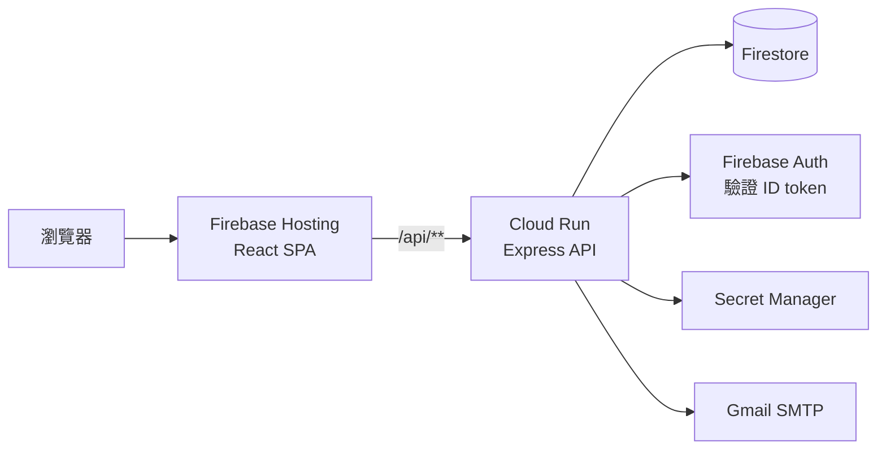

# 當八字遇見人類圖｜Jerome 人類圖解析預約

人類圖解析服務的介紹與線上預約網站。原本是前端直接串接寫死 mock data 的 Node 專案，這次重構成有分層、有測試、可部署到 GCP 的 React + REST API 作品。

> 內容僅供自我探索參考，不構成醫療、心理或財務建議。
> 目前的圖片為 picsum.photos 佔位圖，匯款帳號為示範資料。

## 功能

- 週曆顯示可預約時段：桌面為週表格，手機為日期 chip 加時段清單
- 會員與訪客共用一套預約流程，訪客用信件中的取消連結取消
- 同一時段同時送出時只會成功一筆
- 我的預約、取消預約（預約開始前 1 天內不可取消）
- Firebase Auth 註冊、登入、重設密碼
- 人類圖介紹、Jerome 經歷、免費音檔、聯絡表單

## 架構



| 層級 | 技術 |
|---|---|
| 前端 | React 18、Vite、MUI、React Query、react-hook-form、zod |
| 後端 | Node 20、Express、zod、firebase-admin、Nodemailer |
| 資料與驗證 | Firestore、Firebase Auth |
| 部署 | Firebase Hosting、Cloud Run、Secret Manager、GitHub Actions |
| 測試 | Vitest、Testing Library、msw、supertest、Firebase Emulator |

網站文字、服務與顯示價格都寫在前端的 `web/src/data/`，後端只處理預約相關功能：`routes/` 放 API，`lib/` 放可預約計算、Firestore 存取與寄信。Firestore 只存預約資料。註冊與登入由前端的 Firebase Auth 處理，後端負責驗證 token。

## REST API（`/api/v1`）

| Method | Path | 驗證 | 說明 |
|---|---|---|---|
| GET | `/health` | – | 健康檢查 |
| GET | `/availability?from&to&durationMin` | – | 週曆資料，只回狀態，不含預約者資訊 |
| POST | `/bookings` | 選用 | 建立預約，未登入須填 `guestEmail` |
| GET | `/me/bookings` | 必要 | 自己的預約 |
| DELETE | `/bookings/:id` | 本人或 `?token=` | 取消預約 |

錯誤格式統一為 `{ "error": { "code", "message", "details" } }`。

## 技術決策

- **用 transaction 加 `slotLocks` 防重複預約**：先查再寫有競爭條件。每個 2 小時時段一份鎖文件，同一時段被兩人同時預約時，一定會撞到同一份文件。測試用 Emulator 實際併發驗證。
- **同網域 `/api/**` rewrite**：前端打相對路徑，不需要 CORS，也不用把後端網址寫進前端。
- **用 Firebase ID token，不用 session**：Firebase Hosting 只轉送 `__session` cookie；無狀態的後端也才能在 Cloud Run 水平擴展。
- **時間一律存 UTC，以 `Asia/Taipei` 計算**：伺服器在 UTC 時區也不會差 8 小時，測試涵蓋不同伺服器時區。
- **寄信失敗不讓預約失敗**：預約已經提交，API 回傳 `emailSent`，畫面據實顯示，並提供取消連結。
- **價格只由伺服器決定**：請求的 schema 不接受價格欄位，金額取自 `server/src/config/services.js`，避免被竄改。
- **Workload Identity Federation**：GitHub Actions 部署不需要長期有效的 JSON key。

## 原版問題與改善對照

| 原版問題 | 改善 |
|---|---|
| 資料庫與 Gmail 憑證寫死在公開 repo | 改用環境變數與 Secret Manager |
| 用「資料庫第一筆 session」判斷目前使用者，多人同時使用會錯 | 每個請求驗證 ID token，後端無狀態 |
| 密碼明文存放，忘記密碼時直接寄出 | 交給 Firebase Auth，瀏覽器不再保存密碼 |
| 知道 id 就能刪任何人的預約 | 驗證本人，訪客用只存 hash 的取消 token |
| 衝突檢查拆開比較時分，且只檢查第一筆 | 純函式計算加上 transaction |
| 查詢與寫入非原子操作，會重複預約 | Firestore transaction，併發測試只成功一筆 |
| 部署到 UTC 主機時間差 8 小時 | 統一以 Asia/Taipei 計算 |
| API 網址散落約 20 處，登出打到 localhost | 統一 API client 與 React Query hooks |
| 三份約 410 行幾乎相同的日曆元件 | 一個 `BookingForm` |
| 沒有任何測試 | 前端 32 個、後端 66 個測試，加 CI |
| 單一 JS bundle 915 kB、gzip 269 kB | 路由拆包，主 JS gzip 約 137 kB |
| 手機版跑版、字型未載入、Bootstrap 與 MUI 樣式衝突 | 設計 tokens、單一 theme，375 / 768 / 1280 無水平捲動，Lighthouse 無障礙 100 |

## 本機開發

需要 Node 20 以上、Firebase CLI 與 Java。

```bash
cp web/.env.example web/.env.local
cp server/.env.example server/.env
npm --prefix web install
npm --prefix server install

firebase emulators:start --only auth,firestore --project demo-humandesign
npm --prefix server run dev       # http://localhost:8080
npm --prefix web run dev          # http://localhost:5173，/api 代理到 8080
```

```bash
npm run lint
npm test                          # 前端測試，加上在 emulator 上執行的後端測試
npm run build
```

環境變數的項目見 `web/.env.example` 與 `server/.env.example`，實際的值不可提交到版本控制。詳細說明見下一節。

## 環境變數

### 存放位置

| 位置 | 給誰用 | 內容 |
|---|---|---|
| `web/.env.local`、`server/.env` | 本機開發 | 從 `.env.example` 複製後填值，已列入 `.gitignore` |
| GitHub Variables（Settings → Secrets and variables → Actions → Variables） | GitHub Actions 部署 | WIF 設定與前端 `VITE_*` 值 |
| GCP Secret Manager | Cloud Run 執行時 | `GMAIL_USER`、`GMAIL_APP_PASSWORD` |
| Cloud Run 服務設定 | Cloud Run 執行時 | `deploy-api.sh` 用 `--set-env-vars` 寫入的一般設定 |

### 前端在打包時讀取，後端在執行時讀取

- **前端**：程式用 `import.meta.env.VITE_*` 讀取。`npm run build` 時，Vite 會把這些值直接換成字串寫進 `web/dist/*.js`，所以：
  - 只有 `VITE_` 開頭的變數會被打包，避免誤把伺服器密碼打包出去。
  - 打包後任何人都能在瀏覽器看到這些值，只能放公開的值。Firebase Web 設定與 EmailJS public key 本來就是公開的，安全性靠 Firebase 的網域限制與後端驗證。
  - 改了值必須**重新 build 並重新部署 Hosting** 才會生效。
- **後端**：程式用 `process.env.*` 讀取。Cloud Run 啟動容器時注入變數，`server/src/index.js` 再呼叫 `loadEnv()`（`server/src/config/env.js`）用 zod 檢查。正式環境缺少 Gmail 設定時，服務會在啟動時直接失敗，而不是等到寄信才出錯。
  - 本機由 `dotenv` 讀取 `server/.env`，不會覆蓋已經存在的環境變數。
  - Docker 映像檔裡沒有 `.env`（`.dockerignore` 排除），密碼只在執行時存在。
  - 改了值要**重新部署 Cloud Run**（產生新的 revision）才會生效。

### 前端變數

| 變數 | 讀取位置 | 功能 |
|---|---|---|
| `VITE_API_BASE_URL` | `web/src/api/client.js` | API 網址前綴，未設定時為 `/api/v1`（同網域 rewrite 到 Cloud Run）。測試時由 `web/vite.config.js` 設為 `http://localhost/api/v1` |
| `VITE_FIREBASE_API_KEY`、`VITE_FIREBASE_AUTH_DOMAIN`、`VITE_FIREBASE_PROJECT_ID`、`VITE_FIREBASE_APP_ID` | `web/src/lib/firebase.js` | 初始化 Firebase Auth，用於註冊、登入、重設密碼與取得 ID token。值錯誤時登入會回 400 |
| `VITE_FIREBASE_AUTH_EMULATOR_URL` | `web/src/lib/firebase.js` | 僅本機：設定後改連 Auth Emulator |
| `VITE_EMAILJS_SERVICE_ID`、`VITE_EMAILJS_TEMPLATE_ID`、`VITE_EMAILJS_PUBLIC_KEY` | `web/src/features/content/ContactPage.jsx` | 「聯絡我們」表單透過 EmailJS 寄信 |

### 後端變數

| 變數 | 來源（正式環境） | 功能 |
|---|---|---|
| `NODE_ENV` | `server/Dockerfile` 設為 `production` | 決定是否強制要求 Gmail 設定 |
| `PORT` | Cloud Run 自動提供（8080） | Express 監聽的 port |
| `WEB_BASE_URL` | `deploy-api.sh`（`https://<專案>.web.app`） | 確認信中取消連結的網址 |
| `TRUST_PROXY_HOPS` | `deploy-api.sh`（2：Hosting + Cloud Run） | 讓 Express 取得真實使用者 IP，給 rate limit 使用 |
| `GOOGLE_CLOUD_PROJECT` | `deploy-api.sh` | `server/src/lib/firebase.js` 初始化 firebase-admin 用的專案 ID |
| `GMAIL_USER`、`GMAIL_APP_PASSWORD` | Secret Manager，`deploy-api.sh` 用 `--set-secrets ...:latest` 注入 | Nodemailer 寄預約確認信與取消通知 |
| `FIRESTORE_EMULATOR_HOST`、`FIREBASE_AUTH_EMULATOR_HOST` | 僅本機與 CI | firebase-admin 自動改連 Emulator，測試不會碰到正式資料 |

Secret Manager 不是 repo 裡的檔案，而是 GCP 的服務，可在 [GCP Console](https://console.cloud.google.com/security/secret-manager?project=humandesign-64ea8) 檢視。repo 裡只出現 secret 的名稱：

```
scripts/gcp-bootstrap.sh   啟用 Secret Manager、授權 Cloud Run 讀取、詢問並建立兩個 secret
        │
Secret Manager（值存在 Google）
        │  scripts/deploy-api.sh --set-secrets
        ▼
Cloud Run 容器 process.env ──► server/src/config/env.js 檢查 ──► index.js 傳給寄信模組
```

### GitHub Actions 使用的變數

`.github/workflows/deploy.yml` 在 push 到 `main` 後依序執行：

1. **認證**：用 `vars.WIF_PROVIDER` 與 `vars.DEPLOY_SERVICE_ACCOUNT` 透過 Workload Identity Federation 換取 GCP 短期憑證。兩個變數沒設定時，部署 job 會跳過。
2. **部署後端**：執行 `deploy-api.sh`，設定 Cloud Run 的 env 與 secrets。
3. **打包前端**：在 `Build web` 步驟用 `env:` 把 7 個 `vars.VITE_*` 傳給 `npm run build`，寫進 JS。
4. **部署前端**：`firebase deploy` 上傳到 Hosting。
5. **Smoke test**：用 workflow 內的 `env.PROJECT_ID`（`humandesign-64ea8`）組網址檢查線上服務。

另外有兩類變數由工具自動產生，不需要設定：

- `google-github-actions/auth` 產生 `GOOGLE_APPLICATION_CREDENTIALS`，讓後續的 `gcloud` 與 `firebase` 指令登入。
- 後端測試指令（`server/package.json` 的 `firebase emulators:exec`）在本機與 CI 都會設定 `FIRESTORE_EMULATOR_HOST` 等，讓測試只連 Emulator。

這些值都用 Variables 而不是 Secrets，因為都不是密碼：WIF 不需要金鑰，前端的值本來就會公開。

### 改了變數後要做什麼

| 改了什麼 | 要做的事 |
|---|---|
| GitHub 的 `VITE_*` | 重新執行 deploy workflow（或本機 build 後 `firebase deploy --only hosting`） |
| `web/.env.local` | 重新啟動 `npm run dev`，或重新 build |
| Secret Manager 的 Gmail 值 | 新增 secret 版本後執行 `deploy-api.sh` |
| `deploy-api.sh` 中的 env | 執行 `deploy-api.sh` |
| `server/.env` | 重新啟動 `npm run dev` |
| `WIF_PROVIDER`、`DEPLOY_SERVICE_ACCOUNT` | 下次 workflow 執行時生效 |

## 部署

```bash
bash scripts/gcp-bootstrap.sh     # 只需一次，會詢問 Gmail 帳號與應用程式密碼
bash scripts/deploy-api.sh
npm --prefix web run build
firebase deploy --only hosting,firestore --project humandesign-64ea8
bash scripts/smoke-test.sh https://humandesign-64ea8.web.app
```

 gcloud run services update humandesign-api --min-instances=1
