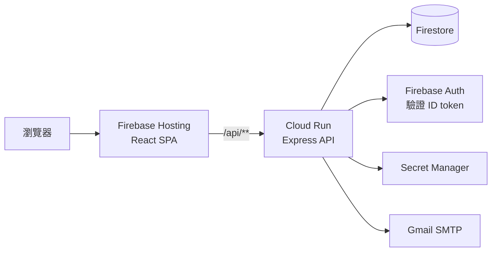

# 當八字遇見人類圖｜Jerome 人類圖解析預約

人類圖解析服務的介紹與線上預約網站。原本是前端直接串接寫死 mock data 的 Node 專案，這次重構成有分層、有測試、可部署到 GCP 的 React + REST API 作品。

> 內容僅供自我探索參考，不構成醫療、心理或財務建議。
> 目前的圖片為 picsum.photos 佔位圖，匯款帳號為示範資料。

## 功能

- 週曆顯示可預約時段：桌面為週表格，手機為日期 chip 加時段清單
- 會員與訪客共用一套預約流程，訪客用信件中的取消連結取消
- 同一時段同時送出時只會成功一筆
- 我的預約、取消預約（預約開始前 1 天內不可取消）
- Firebase Auth 註冊、登入、重設密碼
- 人類圖介紹、Jerome 經歷、免費音檔、聯絡表單

## 架構



| 層級 | 技術 |
|---|---|
| 前端 | React 18、Vite、MUI、React Query、react-hook-form、zod |
| 後端 | Node 20、Express、zod、firebase-admin、Nodemailer |
| 資料與驗證 | Firestore、Firebase Auth |
| 部署 | Firebase Hosting、Cloud Run、Secret Manager、GitHub Actions |
| 測試 | Vitest、Testing Library、msw、supertest、Firebase Emulator |

後端結構很簡單：`routes/` 處理 API 與預約流程，`lib/` 放可預約計算、Firestore 存取與寄信。可預約時段的計算是純函式，方便單元測試。

## REST API（`/api/v1`）

| Method | Path | 驗證 | 說明 |
|---|---|---|---|
| GET | `/health` | – | 健康檢查 |
| GET | `/services` | – | 服務與價格 |
| GET | `/content/:section` | – | 頁面內容 |
| GET | `/about/timeline` | – | Jerome 經歷 |
| GET | `/feedback/videos` | – | 影片清單 |
| GET | `/availability?from&to&durationMin` | – | 週曆資料，只回狀態，不含預約者資訊 |
| POST | `/bookings` | 選用 | 建立預約，未登入須填 `guestEmail` |
| GET | `/me/bookings` | 必要 | 自己的預約 |
| DELETE | `/bookings/:id` | 本人或 `?token=` | 取消預約 |

錯誤格式統一為 `{ "error": { "code", "message", "details" } }`。

## 技術決策

- **用 transaction 加 `slotLocks` 防重複預約**：先查再寫有競爭條件。每 30 分鐘一份鎖文件，涵蓋服務時間與 buffer，兩筆重疊的預約一定會撞到同一份文件。測試用 Emulator 實際併發驗證。
- **同網域 `/api/**` rewrite**：前端打相對路徑，不需要 CORS，也不用把後端網址寫進前端。
- **用 Firebase ID token，不用 session**：Firebase Hosting 只轉送 `__session` cookie；無狀態的後端也才能在 Cloud Run 水平擴展。
- **時間一律存 UTC，以 `Asia/Taipei` 計算**：伺服器在 UTC 時區也不會差 8 小時，測試涵蓋不同伺服器時區。
- **寄信失敗不讓預約失敗**：預約已經提交，API 回傳 `emailSent`，畫面據實顯示，並提供取消連結。
- **價格只由伺服器決定**：請求的 schema 不接受價格欄位，避免被竄改。
- **Workload Identity Federation**：GitHub Actions 部署不需要長期有效的 JSON key。

## 原版問題與改善對照

| 原版問題 | 改善 |
|---|---|
| 資料庫與 Gmail 憑證寫死在公開 repo | 改用環境變數與 Secret Manager |
| 用「資料庫第一筆 session」判斷目前使用者，多人同時使用會錯 | 每個請求驗證 ID token，後端無狀態 |
| 密碼明文存放，忘記密碼時直接寄出 | 交給 Firebase Auth，瀏覽器不再保存密碼 |
| 知道 id 就能刪任何人的預約 | 驗證本人，訪客用只存 hash 的取消 token |
| 衝突檢查拆開比較時分，且只檢查第一筆 | 純函式計算加上 transaction |
| 查詢與寫入非原子操作，會重複預約 | Firestore transaction，併發測試只成功一筆 |
| 部署到 UTC 主機時間差 8 小時 | 統一以 Asia/Taipei 計算 |
| API 網址散落約 20 處，登出打到 localhost | 統一 API client 與 React Query hooks |
| 三份約 410 行幾乎相同的日曆元件 | 一個 `BookingForm` |
| 沒有任何測試 | 前端 32 個、後端 66 個測試，加 CI |
| 單一 JS bundle 915 kB、gzip 269 kB | 路由拆包，主 JS gzip 約 137 kB |
| 手機版跑版、字型未載入、Bootstrap 與 MUI 樣式衝突 | 設計 tokens、單一 theme，375 / 768 / 1280 無水平捲動，Lighthouse 無障礙 100 |

## 本機開發

需要 Node 20 以上、Firebase CLI 與 Java。

```bash
cp web/.env.example web/.env.local
cp server/.env.example server/.env
npm --prefix web install
npm --prefix server install

firebase emulators:start --only auth,firestore --project demo-humandesign
npm --prefix server run seed      # 另開終端機，寫入 emulator
npm --prefix server run dev       # http://localhost:8080
npm --prefix web run dev          # http://localhost:5173，/api 代理到 8080
```

```bash
npm run lint
npm test                          # 前端測試，加上在 emulator 上執行的後端測試
npm run build
```

環境變數的項目見 `web/.env.example` 與 `server/.env.example`，實際的值不可提交到版本控制。

## 部署

```bash
bash scripts/gcp-bootstrap.sh     # 只需一次，會詢問 Gmail 帳號與應用程式密碼
bash scripts/deploy-api.sh
npm --prefix web run build
firebase deploy --only hosting,firestore --project humandesign-64ea8
bash scripts/smoke-test.sh https://humandesign-64ea8.web.app
```

更新正式環境內容時，從 repo 根目錄執行，避免載入指向 emulator 的 `server/.env`：

```bash
GOOGLE_CLOUD_PROJECT=humandesign-64ea8 node server/scripts/seed.js --production
```

面試當天可用 `gcloud run services update humandesign-api --min-instances=1` 避免冷啟動，結束後改回 0。
